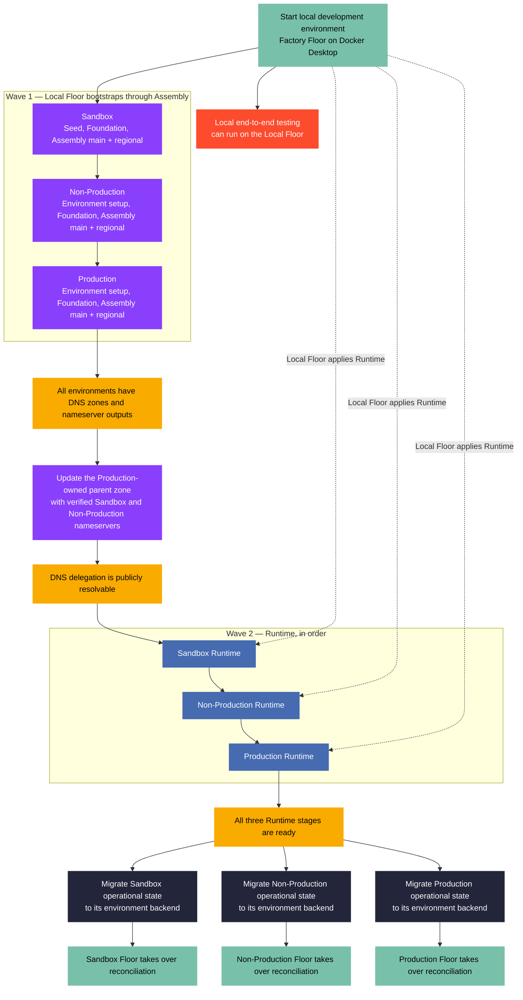
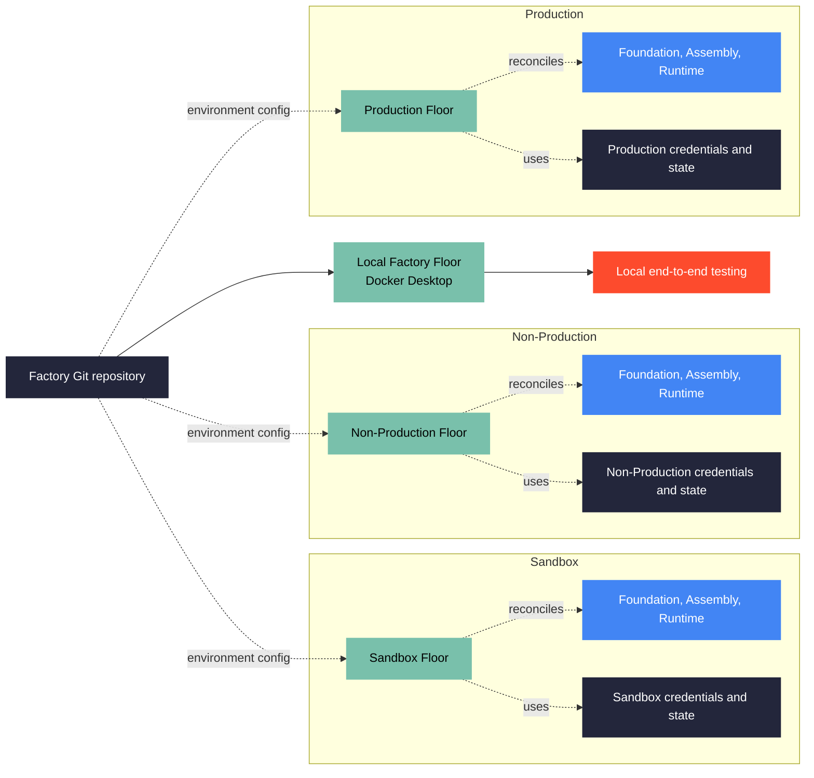

# Environment lifecycle

The planned rollout uses the Local Floor to bootstrap Sandbox, Non-Production,
and Production through Assembly, in that order. Public DNS delegation is a gate
before Runtime. Runtime is then brought up in the same environment order. After
all three Runtime stages are ready, each environment's operational state can be
migrated to its own backend and its Floor can take over.

## Bootstrap sequence

Assembly creates each environment's DNS zone and returns assigned nameservers.
The DNS gate represents publishing and verifying the delegations from the
Production-owned parent zone; creating the child zones alone does not satisfy
the gate.

## Ongoing ownership

The seed's initial state is cluster-local and has a separate migration path:
the migration helper copies it to the environment backend, but switching the
seed workspace to that backend is a separate change. Migrating Foundation,
Assembly, or Runtime state does not transfer seed ownership. The cross-environment
configuration promotion policy is not defined in the current repository.
